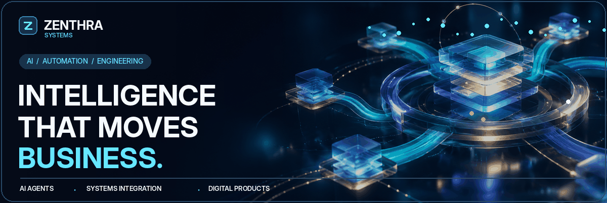
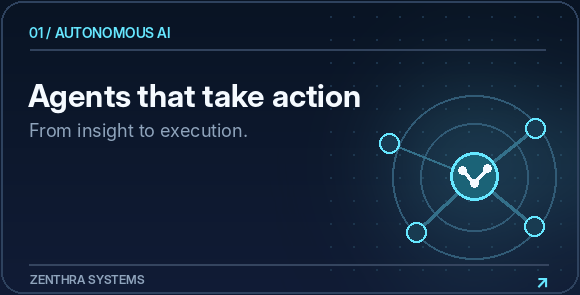
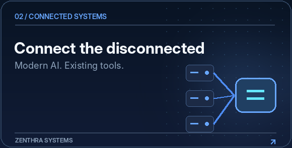
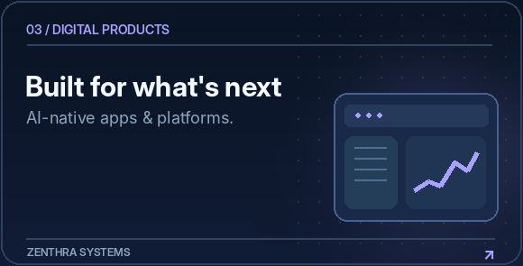
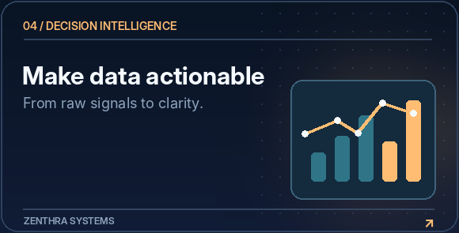
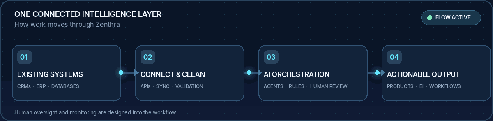
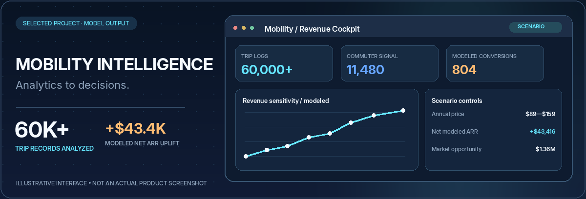
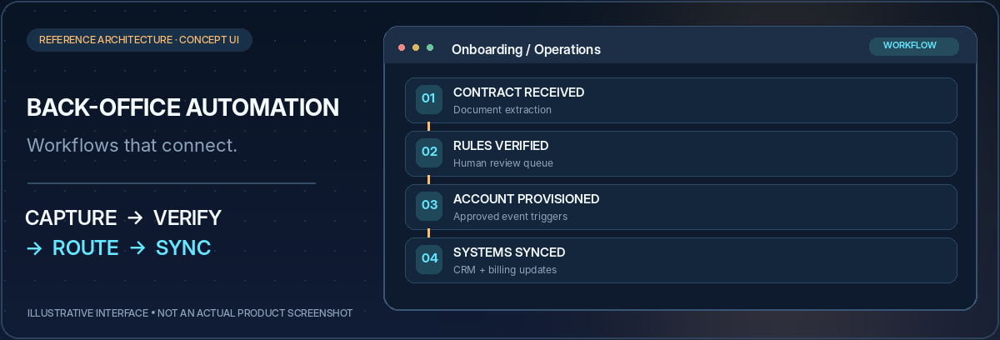
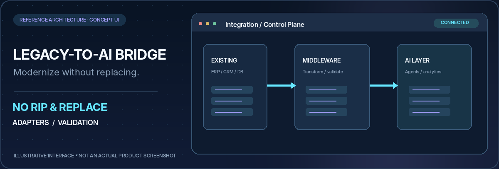
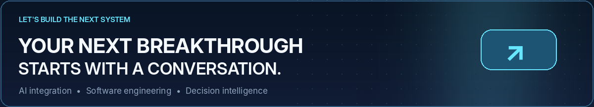

<!-- Zenthra Systems • Personal GitHub Profile README • Cinematic edition -->
<!-- Keep this README and assets/ together. Animated GIFs are local and need no external service. -->

<picture>
  <source media="(prefers-reduced-motion: reduce)" srcset="./assets/hero-poster.jpg" />
  
</picture>

 

### Applied AI. Connected operations. Exceptional software.

<strong>👋 Welcome to our GitHub.</strong> We work on AI-powered products, intelligent automation, and data-driven systems through <strong>Zenthra Systems</strong>. Our focus is turning ambitious ideas into practical, maintainable technology.

<strong>Building at the intersection of AI, software engineering, and real-world operations.</strong>

  
  

<a href="#what-we-build"><strong>Explore what we build</strong></a> &nbsp;·&nbsp; <a href="#selected-work"><strong>Selected work</strong></a> &nbsp;·&nbsp; <a href="#the-integration-engine"><strong>The integration engine</strong></a> &nbsp;·&nbsp; <a href="#build-with-zenthra"><strong>Start a conversation</strong></a>

---

## A little about our work

We use this profile to represent our work and interests across **applied AI, full-stack development, systems integration, and analytics**. Zenthra Systems is the brand behind this work: helping businesses connect existing operations to intelligent, maintainable software.

We believe great engineering means making complicated systems feel simple to the people who use them. That is why we care about **reliable integrations, thoughtful interfaces, human oversight, and measurable business value**.

**Keep what works. Connect what matters. Automate what creates value.**

## What we build

<table>
<tr>
<td width="50%" valign="top">
  
  <h3>01 · Autonomous AI &amp; intelligent workflows</h3>
  
AI agents, retrieval-augmented knowledge, document intelligence, process orchestration, and practical human approval checkpoints.

</td>
<td width="50%" valign="top">
  
  <h3>02 · Systems integration &amp; modernization</h3>
  
Custom API bridges, CRM/ERP synchronization, data cleanup, reliable handoffs, and legacy-to-AI integrations without an unnecessary rip-and-replace.

</td>
</tr>
<tr>
<td width="50%" valign="top">
  
  <h3>03 · AI-native web &amp; mobile products</h3>
  
Customer portals, commerce experiences, operations platforms, and mobile applications designed with modern engineering and purposeful AI.

</td>
<td width="50%" valign="top">
  
  <h3>04 · Business intelligence &amp; technical R&amp;D</h3>
  
Python-based data pipelines, BI dashboards, scenario modeling, machine-learning prototypes, and reproducible technical research.

</td>
</tr>
</table>

## The integration engine

<picture>
  <source media="(prefers-reduced-motion: reduce)" srcset="./assets/integration-poster.png" />
  
</picture>

**Existing tools → trusted connections → AI orchestration → actionable business outcomes.**

AI is most useful when it fits the operation—not when it becomes another isolated application. The approach emphasizes safe data handling, monitoring, human review where needed, and maintainable handovers.

## Selected work

### Urban mobility — Revenue intelligence &amp; financial modeling

A data-to-decision engagement spanning Python ETL, behavioral segmentation, executive BI, and interactive financial scenario analysis.

| Data signal | Project summary |
| :-- | --: |
| Raw trip records processed | **60,000+** |
| Weekday commuter-casual trips identified | **11,480** |
| Potential annual conversions in the modeled scenario | **804** |
| Modeled net annual recurring revenue uplift | **+$43,416** |

**Evidence &amp; visual note:** The graphic above is an illustrative interface created for this README, not an authentic product screenshot. Figures are based on the project narrative supplied by Zenthra. Conversion, revenue and market-size figures are scenario estimates, not independently verified realized results. Confirm permission before public disclosure.

### AI-assisted onboarding &amp; back-office orchestration

**Reference architecture:** Connect document intake, contract checks, approval checkpoints, account provisioning, CRM updates and invoicing. The objective is fewer repetitive handoffs and better operational consistency.

### Legacy-to-AI integration bridge

**Reference architecture:** Link existing databases, spreadsheets, CRMs and applications to modern APIs and AI workflows through validation, data transformation and reviewable connections—without demanding a full platform replacement.

The two reference architectures above are proposed solution patterns, not verified client deployments. Their visuals are illustrative.

## Our engineering approach

| Phase | What happens | Why it matters |
| :--: | :-- | :-- |
| **01** · Discover | Map operations, constraints and measurable goals | Solve the right problem |
| **02** · Architect | Model integrations, security boundaries and decision ownership | Reduce surprises |
| **03** · Engineer | Build reviewable components and working interfaces | Deliver maintainable systems |
| **04** · Validate | Test edge cases, permissions, data flows and human checkpoints | Improve reliability |
| **05** · Evolve | Deploy, document, monitor and improve | Support long-term value |

## Engineering toolkit

**AI &amp; ML** · Python · PyTorch · TensorFlow · scikit-learn · RAG / LLM workflows  
**Apps &amp; interfaces** · Next.js · React · TypeScript · Node.js · FastAPI · Flutter  
**Data &amp; BI** · Pandas · NumPy · PostgreSQL · Power BI · Plotly · Snowflake  
**Cloud &amp; delivery** · Docker · Kubernetes · GitHub Actions · Google Cloud · Vercel · n8n

  
<b>Explore additional capabilities and engineering tools</b>

   

| Area | Technologies |
| :-- | :-- |
| Applied ML &amp; research | SciPy, OpenCV, Keras, CUDA, MLflow, explainability workflows |
| Application systems | Django, Flask, Express, NestJS, React Native, Tailwind CSS |
| Data systems | MySQL, MongoDB, SQLite, Firebase, ETL / ELT, API integration |
| Engineering operations | Git, GitLab, Postman, Selenium, GitHub Actions, testing &amp; documentation |

Technology choices depend on requirements, security, supportability, and the business problem—not the length of a tool list.

## Build with Zenthra

Whether you are exploring an AI integration, an operational automation, or a new digital product, we welcome conversations about meaningful engineering problems.

<strong>Tell us what you need to connect, build, or automate.</strong>

### [connect.zenthra@gmail.com](mailto:connect.zenthra@gmail.com?subject=Project%20Inquiry%20-%20Zenthra%20Systems)

United States &nbsp;·&nbsp; Bangladesh &nbsp;·&nbsp; Remote collaboration worldwide

For confidential projects, please email details privately. Client or project information is shared publicly only with permission.

---

© Zenthra Systems · Applied intelligence, responsibly engineered.

